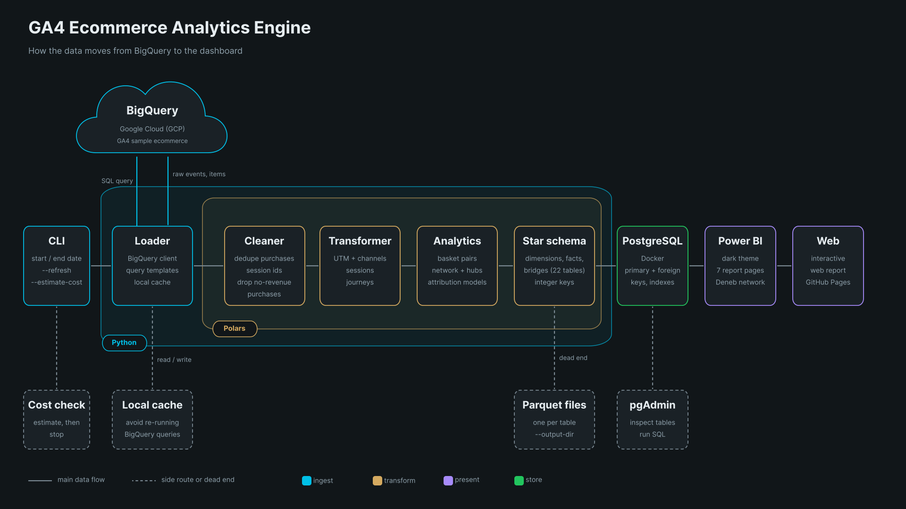
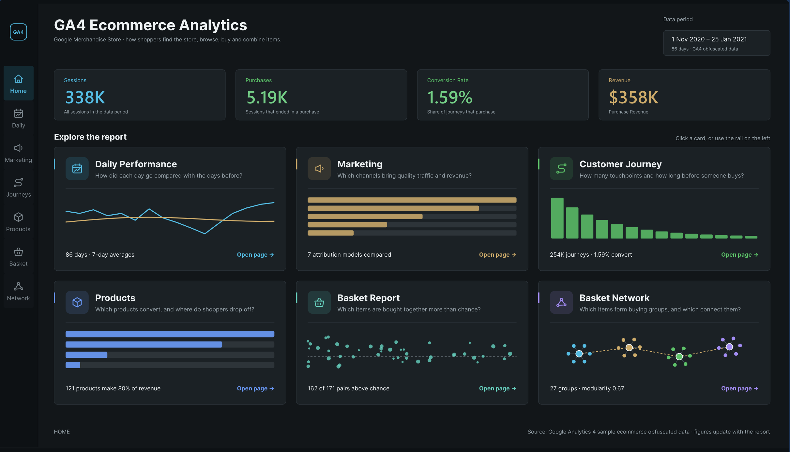

# GA4 Ecommerce Analytics Engine



[](https://app.powerbi.com/view?r=eyJrIjoiMGQ2OGMwMGMtMDQyNS00ZjU1LTlhYWItZGQ3Njc2Yjg2ZmMzIiwidCI6ImQ1OTViMWJhLTJmNmQtNGMxNi1iOWI1LTViMGQ3YmM5MzNlNSJ9)



Turns the public GA4 sample ecommerce data (Google Merchandise Store, Nov. 1st, 2020 to Jan. 31st, 2021) into a star schema
in Postgres and a seven-page Power BI report: daily performance, marketing and attribution, customer journeys,
products and funnel, basket analysis, and an item network.

## Stack

| Layer | Tools |
|---|---|
| Source | Google BigQuery |
| Transform and analytics | Python, polars, NumPy, NetworkX |
| Warehouse | PostgreSQL 17 and pgAdmin in Docker, loaded with psycopg |
| Report | Power BI, with a Deneb (Vega) network visual |
| Tooling | uv, make, pytest |

## Quick start

```bash
uv sync
cp .env.example .env      # set POSTGRES_PASSWORD
make db-up                # Postgres in Docker
make cost                 # dry-run the BigQuery queries (nothing is billed)
make run-pg               # build everything and load Postgres
```

`make` lists every task. Run `uv run ga4-pipeline --help` for the options.

## Data Quality

> [!WARNING]
> From Jan. 26th, 2021 the source drops purchase revenue (38% of purchases on Jan. 26th and 100% on Jan. 31st), so the data is has a hard cap at Jan. 25th, 2021 instead of Jan. 31st, 2021. This is a direct data quality issue, see:
> [docs/development.md](docs/development.md#reading-the-data).

## Documentation

|                                        |                                                  |
| -------------------------------------- | ------------------------------------------------ |
| [Module flowcharts](docs/modules.md)   | One chart per module                             |
| [Output tables](docs/tables.md)        | Every table, grain, and key                      |
| [Architecture](docs/architecture.md)   | Stages and design rules                          |
| [Analytics methods](docs/analytics.md) | Attribution, basket, and network                 |
| [Power BI](docs/powerbi.md)            | Setup, relationships, measures,  and screenshots |
| [Development](docs/development.md)     | Tests and changing things                        |
|                                        |                                                  |
