# Module flowcharts

One chart per module, in the order the data flows. Cyan boxes are steps, gold boxes are inputs and outputs, dashed
boxes are rows or runs that stop. The last chart shows how `Pipeline.run` calls them all.

## Command line

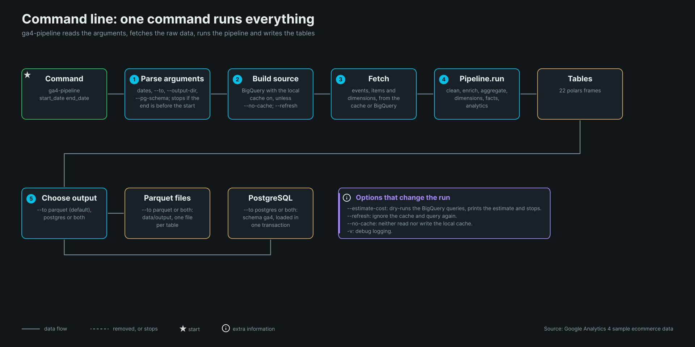

`ga4-pipeline start end` parses the arguments, builds the BigQuery source (local cache on unless `--no-cache`), fetches
the raw data, runs the pipeline and writes parquet, Postgres or both. `--estimate-cost` stops after a dry run.

## Sources

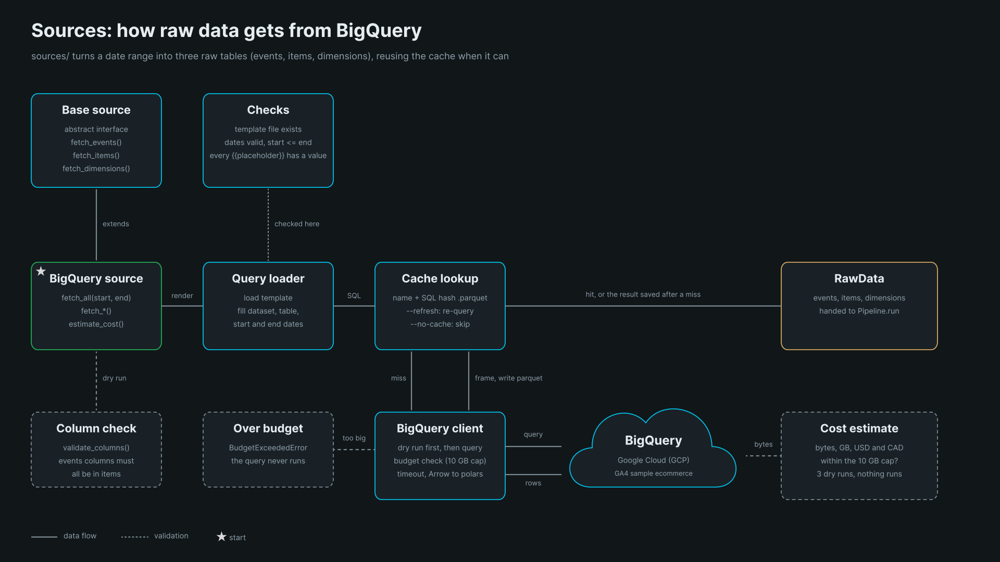

`sources/` renders the SQL templates in `sql/bigquery/`, estimates or runs them, and caches the results as parquet.

## Cleaner

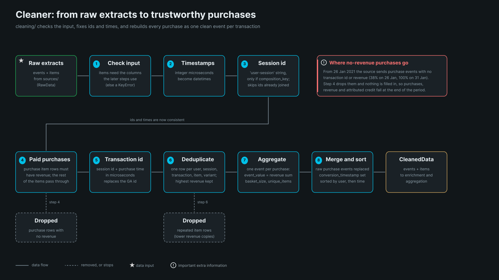

Rebuilds every purchase as one clean event per transaction. Purchases with no revenue are dropped; nothing is filled in
(see the README 'Data Quality' section). The composite session id step only runs when `composition_key` is on, which `Pipeline`
does not set.

## Enrichment

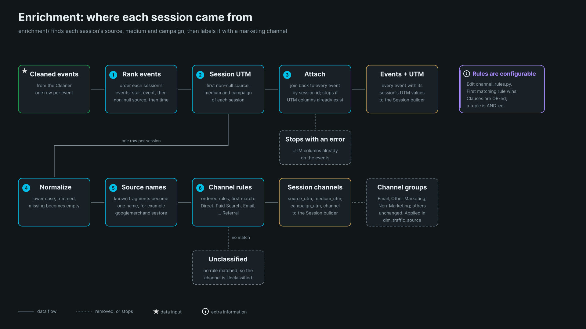

Finds each session's first non-null source, medium and campaign, then labels the session with the first matching channel
rule. A session no rule matches is `Unclassified`.

## Aggregation

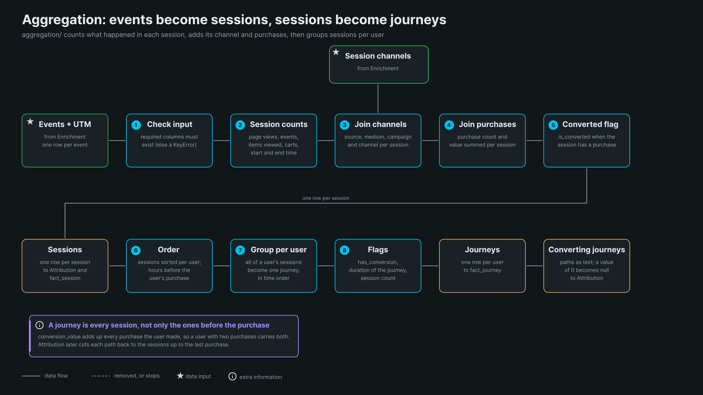

Events become sessions (counts, channel, purchases, converted flag), then sessions become one journey per user. A journey
holds every session, and `conversion_value` adds up every purchase the user made.

## Dimensions

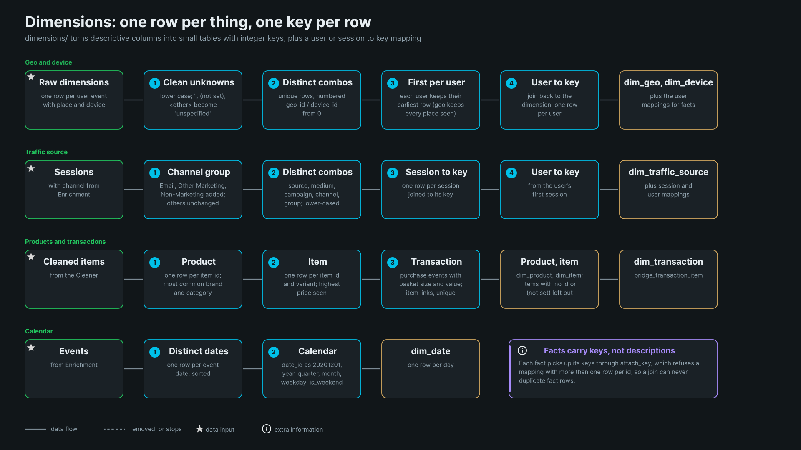

Distinct combinations of descriptive columns get integer keys. Geo and device are mapped per user (first row), traffic
source per session and per user (first session). Values are lower-cased and unknowns become `unspecified`.

## Facts

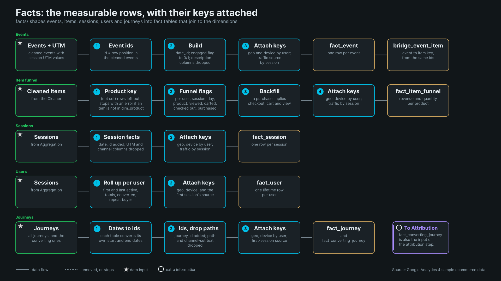

Event, item funnel, session, user and journey facts, each with its dimension keys attached. `fact_converting_journey` is
also the input of attribution.

## Attribution

Cuts each converting user's path at the last purchase session, then shares the purchase value across the touches under
eight models. Rows with zero credit are nogt written.

## Basket analysis

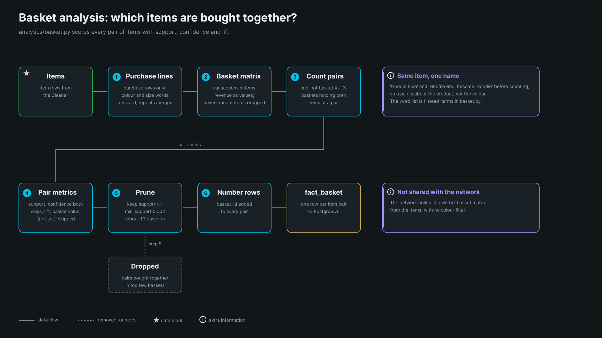

Scores every pair of items with support, confidence both ways, lift and value, then drops pairs with support below
0.002 (about 10 baskets).

## Network

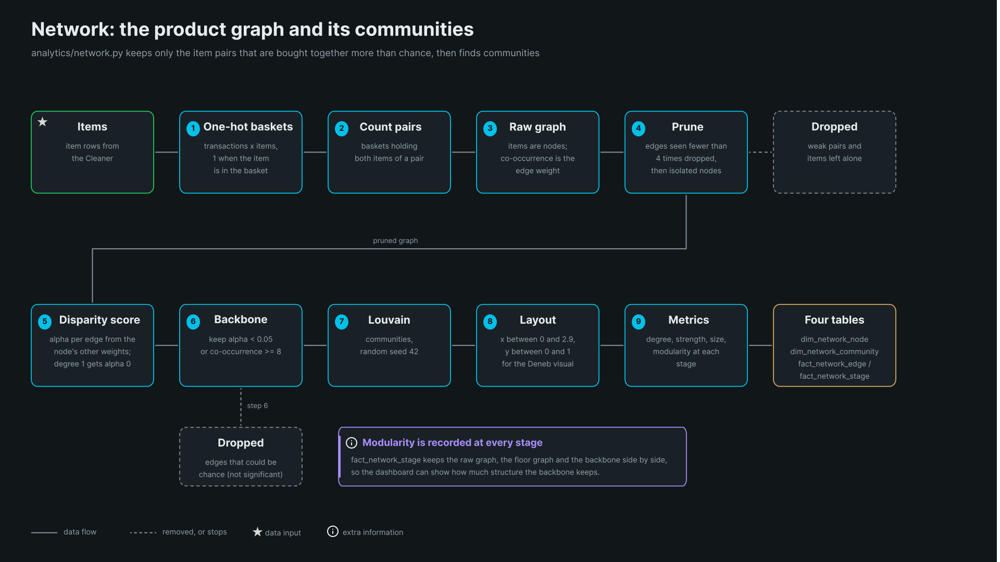

Floor, disparity score, backbone, Louvain communities, layout and metrics, written as four tables. Modularity is recorded
for each stage.

## Writers

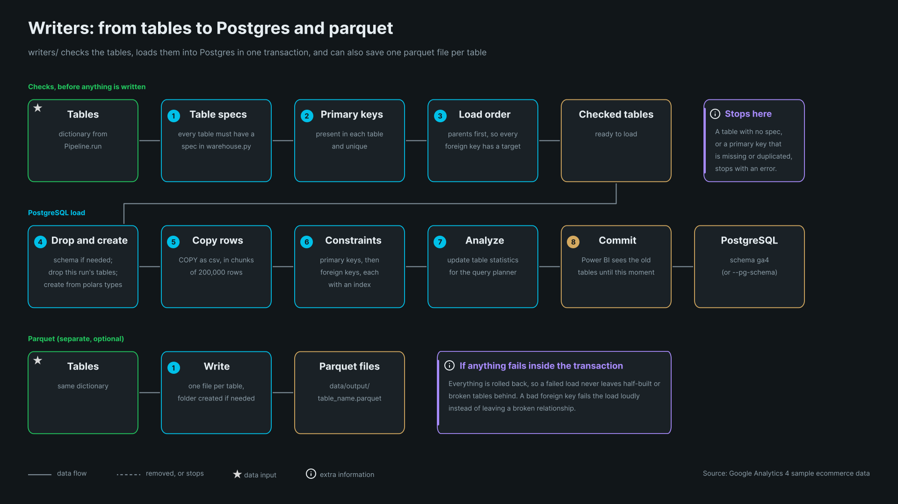

The Postgres load checks the tables first, then does everything in one transaction. Parquet is a separate, optional route.

## Pipeline.run

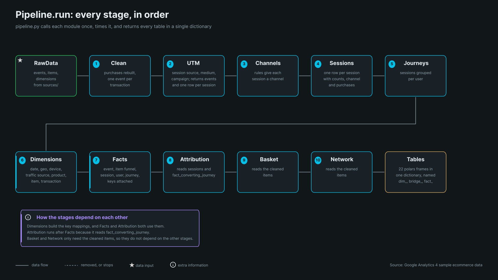

Ten stages in order, returning 22 tables in a dictionary. Attribution runs after the facts; basket and network only need
the cleaned items.
